# Manuel d'utilisation de PAGINITY

**Créer · Gérer · Publier · Suivre** — version 0.3 (prototype, novembre 2026)

Ce manuel explique, écran par écran, comment utiliser PAGINITY. Toutes les images sont de **vraies captures** du
programme, prises sur des données de démonstration : le site « Salon Démo » et une copie du site Coco Nail's.
Les noms, messages et valeurs qu'on y voit sont fictifs.

> PAGINITY fonctionne aujourd'hui en **prototype**, sur un ordinateur de test. L'installation sur le serveur définitif
> (Raspberry Pi ou mini-PC), les sauvegardes automatiques et la mise en ligne avec vos vrais noms de domaine viendront
> aux phases 4 et 5. Le fonctionnement décrit ici restera le même.

---

## Sommaire

1. [Les mots à connaître](#1-les-mots-à-connaître)
2. [Premier démarrage](#2-premier-démarrage)
3. [Se connecter au quotidien](#3-se-connecter-au-quotidien)
4. [Le tableau de bord](#4-le-tableau-de-bord)
5. [Ajouter un site](#5-ajouter-un-site)
6. [Modifier les contenus](#6-modifier-les-contenus)
7. [Les photos et documents](#7-les-photos-et-documents)
8. [Vérifier avec l'aperçu](#8-vérifier-avec-laperçu)
9. [Publier](#9-publier)
10. [Versions et retour en arrière](#10-versions-et-retour-en-arrière)
11. [Le mode code](#11-le-mode-code)
12. [Les messages des formulaires](#12-les-messages-des-formulaires)
13. [Fonctions et tâches planifiées](#13-fonctions-et-tâches-planifiées)
14. [Les secrets](#14-les-secrets)
15. [Réglages d'un site, personnes, export](#15-réglages-dun-site-personnes-export)
16. [Suivre la plateforme](#16-suivre-la-plateforme)
17. [Réglages de la plateforme (e-mails)](#17-réglages-de-la-plateforme-e-mails)
18. [Mon profil et ma sécurité](#18-mon-profil-et-ma-sécurité)
19. [Sur téléphone et tablette](#19-sur-téléphone-et-tablette)
20. [En cas de problème](#20-en-cas-de-problème)
21. [Ce qui n'est pas encore disponible](#21-ce-qui-nest-pas-encore-disponible)

---

## 1. Les mots à connaître

| Mot | Ce que cela veut dire |
|---|---|
| **Brouillon** | Votre version de travail. Tout ce que vous modifiez y est enregistré, **sans être visible du public**. |
| **Aperçu** | Une vue privée du brouillon, pour vérifier avant de publier. |
| **Publier** | Mettre le brouillon en ligne : les visiteurs voient alors la nouvelle version. |
| **Version** (ou publication) | Chaque publication est conservée et numérotée (n°1, n°2…). On peut revenir à une ancienne version. |
| **Rubrique** | Un groupe de contenus modifiables par formulaire (tarifs, horaires, FAQ…). |
| **Fonction** | Un petit programme du site qui travaille « en coulisses » : réservation, facture, envoi d'e-mail… |
| **Tâche planifiée** | Une fonction qui se lance toute seule à heure fixe (par exemple les rappels de rendez-vous). |
| **Secret** | Un mot de passe ou une clé d'accès utilisé par les fonctions (Google, OVH, SumUp…). |
| **Double authentification** | En plus du mot de passe, un code à 6 chiffres ou une passkey (empreinte, visage). |

**Les rôles.** Chaque personne a un rôle sur chaque site :

| Rôle | Peut faire |
|---|---|
| Contributeur | Modifier les contenus et les photos (brouillon). Ne peut pas publier. |
| Éditeur | Tout ce que fait le contributeur, plus publier, revenir en arrière et lire les messages des formulaires. |
| Administrateur du site | Tout, y compris le code des pages (HTML, styles, scripts du navigateur), les secrets, les réglages et les personnes du site. |
| Propriétaire | Vous : tous les sites, les utilisateurs, la santé du serveur, le journal, les réglages. Vous seul pouvez modifier le **code exécuté sur le serveur** (fonctions, étape de préparation, réglages de fabrication, dépendances). |

---

## 2. Premier démarrage

À la toute première ouverture, PAGINITY demande de créer le compte **propriétaire**.

1. Saisissez le **code d'installation**. Il s'affiche dans la fenêtre où le serveur a été démarré : cela garantit
   que personne d'autre ne peut créer ce compte à votre place.
2. Indiquez votre nom, votre adresse e-mail et un **mot de passe d'au moins 12 caractères**. Une phrase de plusieurs
   mots est idéale.
3. Cliquez sur **Créer mon compte**.

PAGINITY impose ensuite la **double authentification** : un mot de passe volé ne suffira jamais pour entrer.

Deux possibilités (vous pouvez ajouter l'autre plus tard dans votre profil) :

- **Application de codes à 6 chiffres** (Google Authenticator, Microsoft Authenticator…) :
  1. installez l'application sur votre téléphone ;
  2. scannez le QR code affiché ;
  3. tapez le code à 6 chiffres que l'application affiche.

  

- **Passkey** : votre empreinte, votre visage ou le code de votre appareil. C'est plus simple et encore plus sûr.

Enfin, PAGINITY affiche **10 codes de secours**.

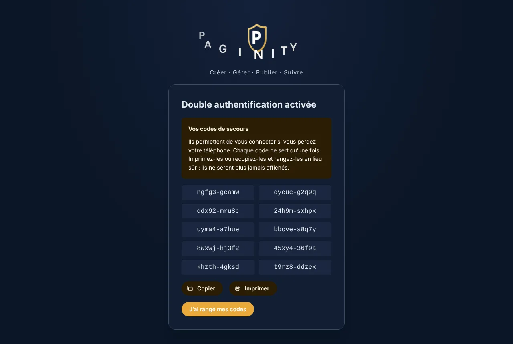

> ⚠️ **Imprimez ou recopiez ces codes et rangez-les en lieu sûr.** Ils servent si vous perdez votre téléphone. Chaque
> code ne sert qu'une fois, et ils ne seront plus jamais affichés. Vous pourrez en générer de nouveaux depuis votre profil.

Cliquez sur **J'ai rangé mes codes** : vous arrivez au tableau de bord.

---

## 3. Se connecter au quotidien

1. Saisissez votre adresse e-mail et votre mot de passe, puis **Continuer**.
2. Saisissez le code à 6 chiffres de votre application, ou touchez **Utiliser ma passkey**.

- Pas de téléphone sous la main ? Touchez **utiliser un code de secours**.
- Après 30 minutes sans activité, PAGINITY vous déconnecte automatiquement.
- Après plusieurs erreurs de mot de passe ou de code, la connexion est bloquée quelques minutes : c'est une protection
  contre les pirates. Si quelqu'un d'autre se trompe sur votre compte, seuls les **nouveaux appareils** sont bloqués :
  les appareils sur lesquels vous vous êtes déjà connecté continuent de fonctionner, et une alerte vous prévient
  dans le tableau de bord.

---

## 4. Le tableau de bord

C'est la page d'accueil : l'état de vos sites et du serveur en un coup d'œil.

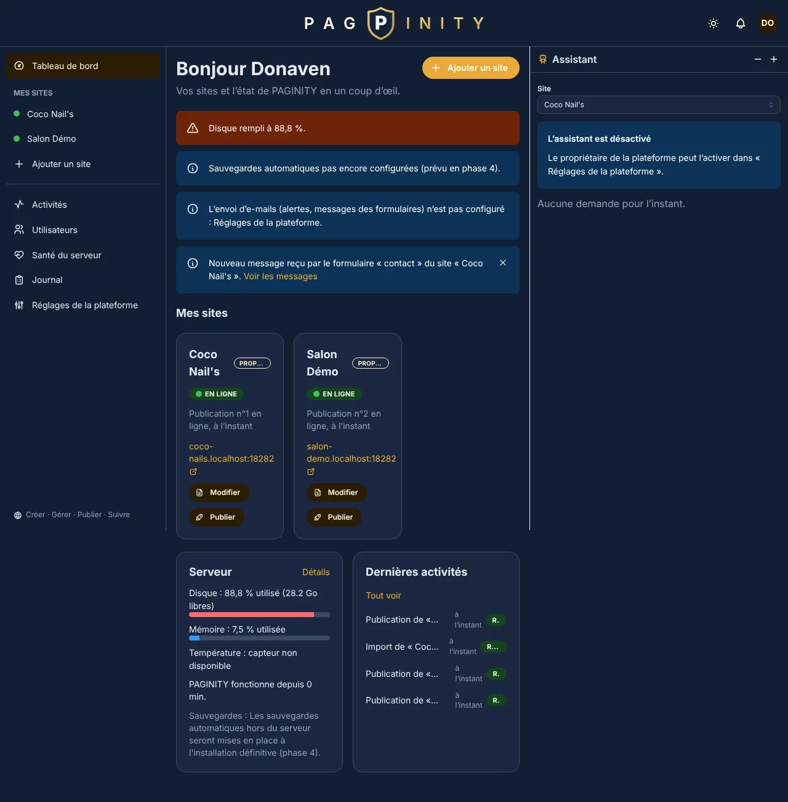

- **Les bandeaux en haut** sont les alertes : bleu = information, orange = à vérifier, rouge = urgent. La croix
  marque une alerte comme lue.
- **Chaque carte de site** indique son état :
  - 🟢 **En ligne** : tout est publié ;
  - 🟠 **Modifications non publiées** : le brouillon contient des changements ;
  - 🔴 **Dernière publication échouée** : l'ancienne version reste en ligne, rien n'est cassé ;
  - ⚪ **Jamais publié**.
- Les boutons **Modifier** et **Publier** mènent directement aux contenus et à la publication.
- **Serveur** : espace disque, mémoire et durée de fonctionnement. **Dernières activités** : les publications et
  imports récents.
- **Le menu de gauche** donne accès à vos sites (cliquez sur un site pour voir ses sections), aux activités, aux
  utilisateurs, à la santé du serveur, au journal et aux réglages.
- **En haut à droite** :
  - ☀️/🌙 pour passer en mode clair ou sombre ;
  - 🔔 pour les activités en cours ;
  - votre pastille pour votre profil et la déconnexion.

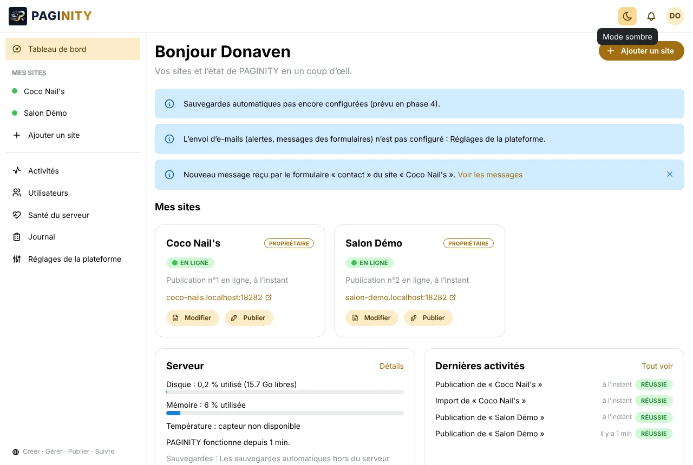

---

## 5. Ajouter un site

Cliquez sur **Ajouter un site**. Un assistant vous guide en 3 étapes.

**Étape 1 — Le nom.** Il pourra être changé plus tard.

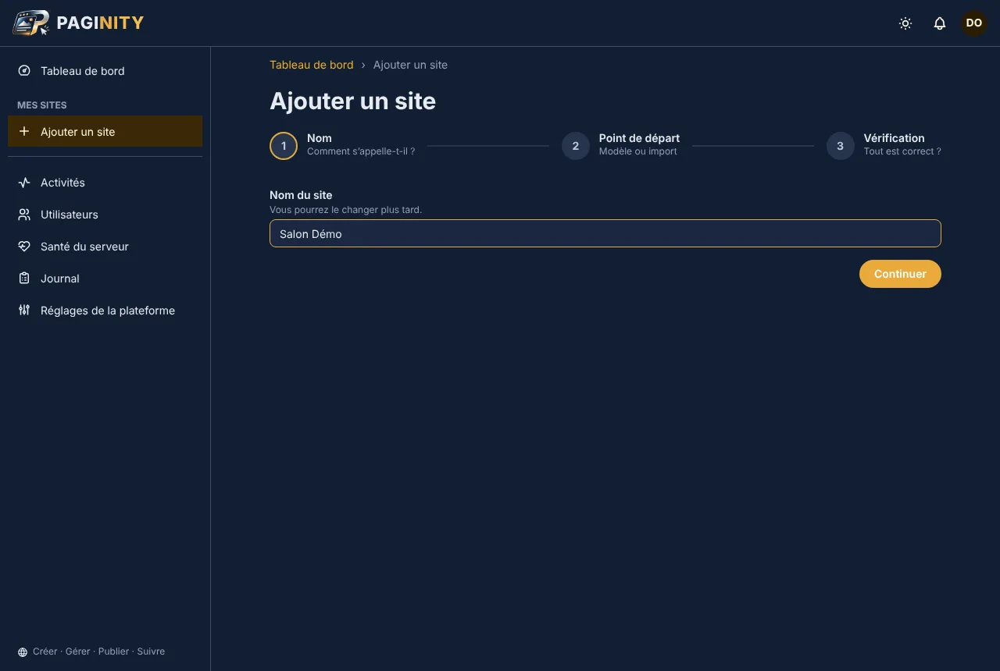

**Étape 2 — Le point de départ** :

- **Partir d'un modèle** : *Vitrine une page* (accueil, prestations et tarifs, horaires, questions fréquentes, contact)
  ou *Site vierge*.

  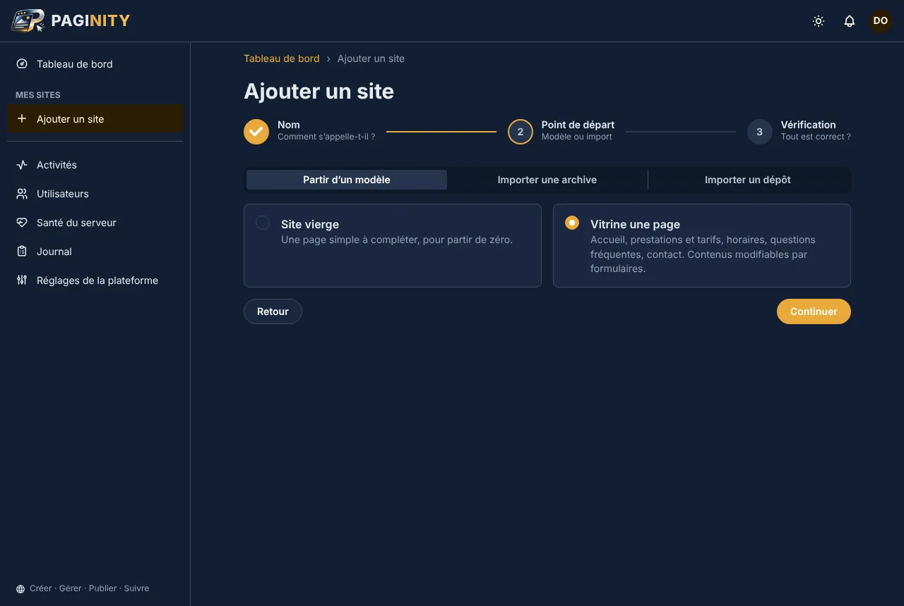

- **Importer une archive** : un fichier ZIP contenant un site existant (HTML, CSS, JavaScript, JSON, images…).
- **Importer un dépôt** : l'adresse d'un dépôt Git public (par exemple sur GitHub).

  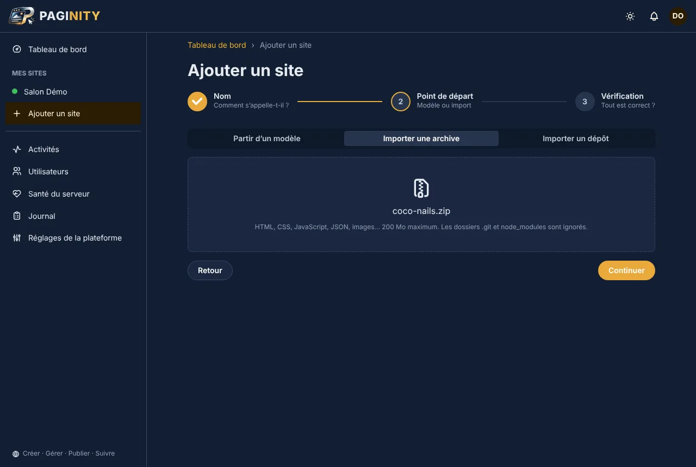

**Étape 3 — Vérification**, puis **Créer le site**.

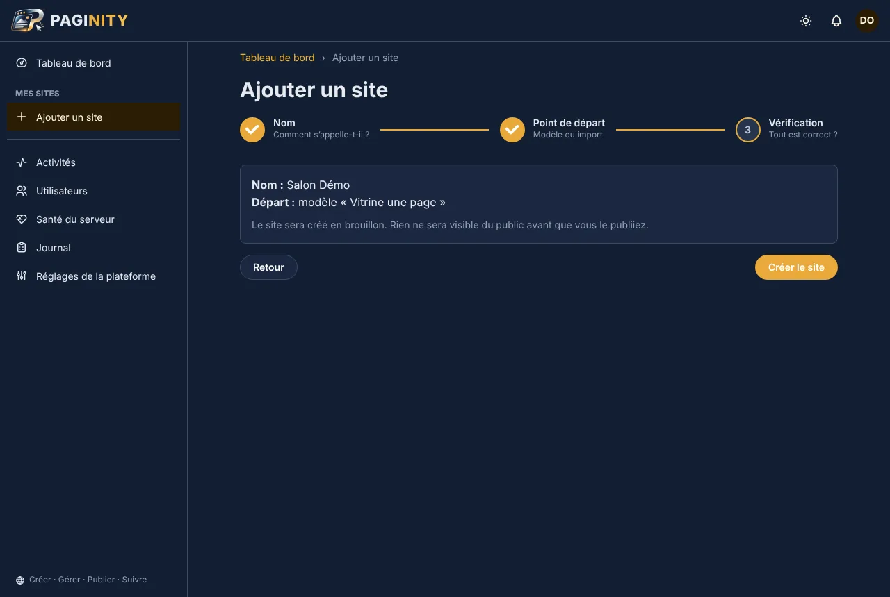

Pour un import, PAGINITY affiche la progression, puis ce qu'il a reconnu : dossier publié, étape de préparation,
fonctions serveur.

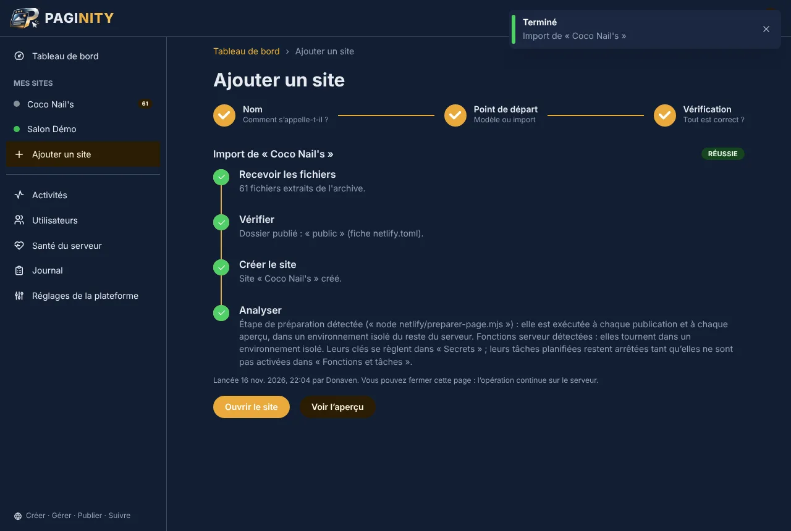

Le site est créé **en brouillon** : rien n'est visible du public avant la première publication. Sa fiche résume tout :

---

## 6. Modifier les contenus

Dans le menu du site, ouvrez **Contenus**. À gauche, les rubriques ; à droite, le formulaire.

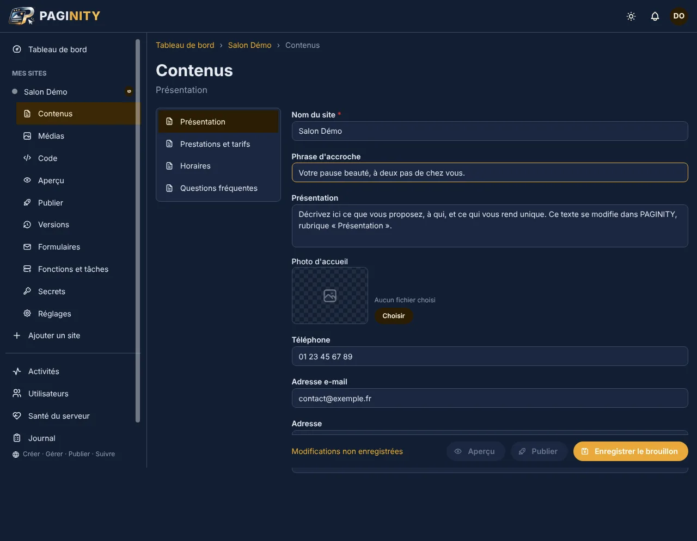

- Chaque champ correspond à une information du site : texte, prix, horaire, oui/non, date, choix dans une liste,
  photo…
- Les champs marqués d'un **astérisque rouge** sont obligatoires. Un champ mal rempli (par exemple une heure au
  mauvais format) s'affiche en rouge avec une explication.
- **Les listes** (prestations, questions…) se gèrent avec les boutons :
  - **Ajouter** ;
  - ↑ et ↓ pour changer l'ordre ;
  - 🗑 pour supprimer (une confirmation est demandée).

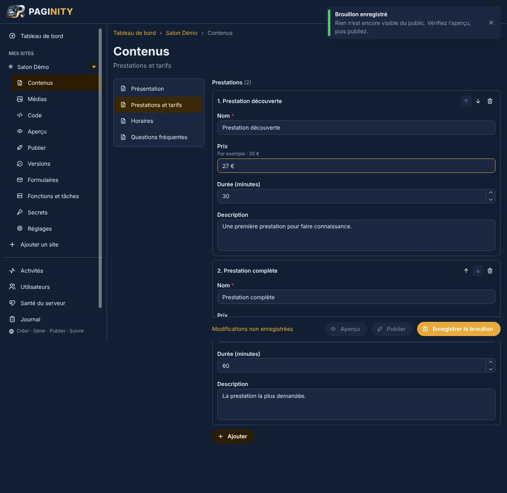

Quand c'est terminé, cliquez sur **Enregistrer le brouillon** (en bas de l'écran).

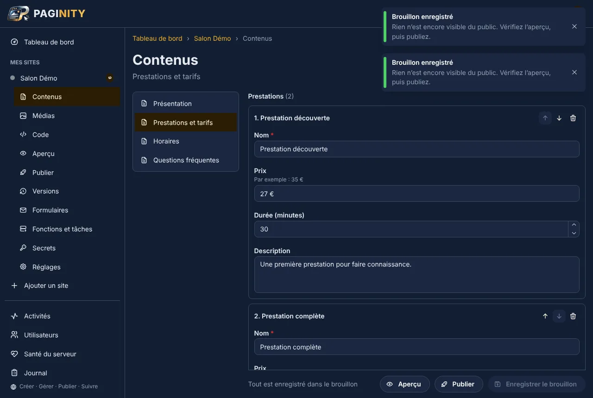

Le message « Brouillon enregistré » confirme : **rien n'est encore visible du public.** Vérifiez l'aperçu, puis publiez.

Pour un site importé, les rubriques viennent de son fichier `.pages.yml` (le même que Pages CMS). Par exemple, les
horaires de Coco Nail's :

**Bon à savoir**
- Si quelqu'un d'autre modifie la même rubrique en même temps, un bandeau bleu vous le signale.
- Si la rubrique a été modifiée ailleurs entre-temps (une autre personne, un autre onglet), PAGINITY **refuse
  d'écraser** son travail et vous propose de recharger la version la plus récente.
- Si vous quittez la page sans enregistrer, le navigateur vous prévient.

---

## 7. Les photos et documents

Ouvrez **Médias**. Déposez des photos ou des PDF dans la zone prévue, ou touchez-la pour les choisir (sur téléphone,
vous pouvez prendre une photo directement).

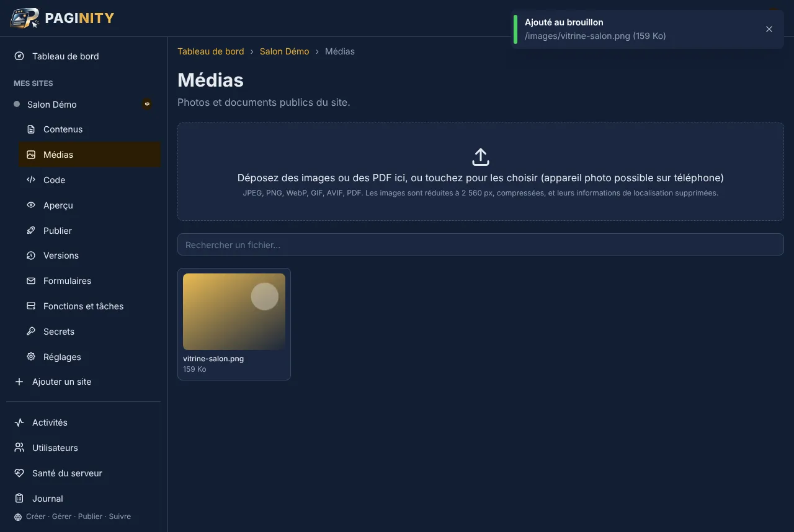

PAGINITY s'occupe de tout :
- les photos sont **redimensionnées** (2 560 pixels maximum) et **compressées** ;
- les **informations de localisation** (GPS) sont supprimées ;
- le vrai type de chaque fichier est vérifié : un fichier dangereux déguisé en image est refusé.

Formats acceptés : JPEG, PNG, WebP, GIF, AVIF et PDF.

Cliquez sur une image pour voir son adresse sur le site, la **remplacer** (même nom, même adresse : toutes les pages
qui l'utilisent sont mises à jour) ou la **supprimer**.

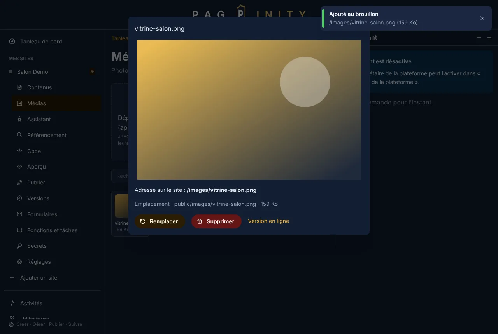

> Si l'image est encore utilisée quelque part, PAGINITY vous l'indique avant la suppression, pour éviter une image
> manquante sur le site.

Dans un formulaire de contenus, un champ « photo » s'utilise avec **Choisir** : vous prenez une image de la
médiathèque, ou vous en envoyez une nouvelle.

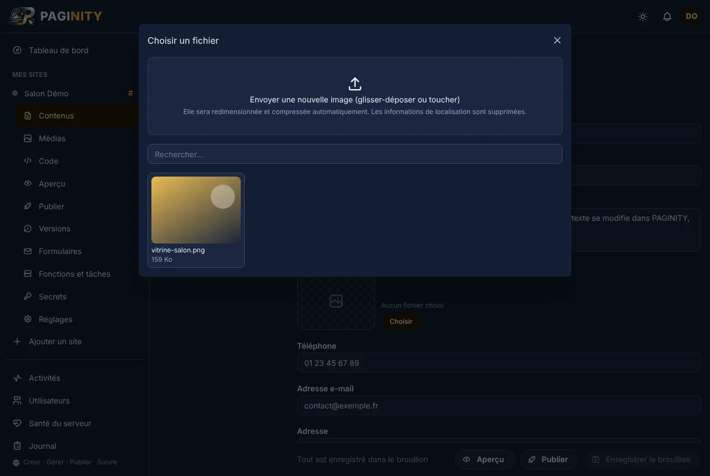

---

## 8. Vérifier avec l'aperçu

Ouvrez **Aperçu** : votre brouillon s'affiche **exactement comme il apparaîtra en ligne**, mais seulement pour vous.

Les boutons **Téléphone**, **Tablette** et **Ordinateur** montrent le site dans chaque format.

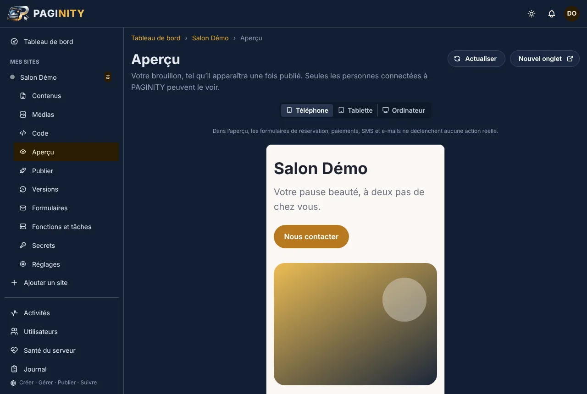

- **Actualiser** reprend vos dernières modifications. **Nouvel onglet** ouvre l'aperçu en grand. Ce lien reste
  valable 2 heures.
- Dans l'aperçu, les formulaires, réservations, SMS et e-mails **ne déclenchent aucune action réelle**. Les pages
  d'aperçu ne peuvent d'ailleurs appeler que leur propre adresse : jamais le site en ligne ni un service extérieur.

---

## 9. Publier

Ouvrez **Publier**. PAGINITY liste tout ce qui a changé depuis la dernière publication, avec l'auteur de chaque
modification.

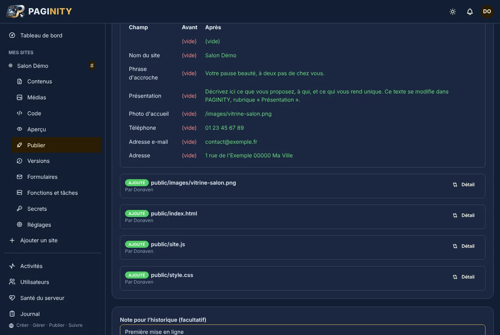

Pour les contenus, le détail s'affiche **champ par champ**, avec la valeur « avant » et la valeur « après » :

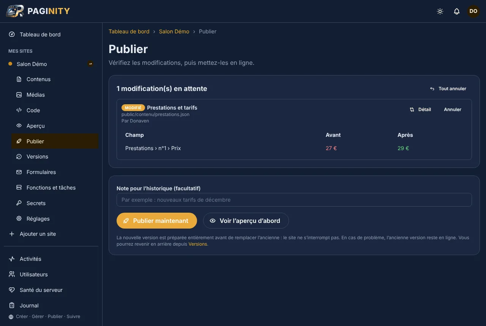

- **Détail** montre la différence ligne par ligne.
- **Annuler** retire une seule modification ; **Tout annuler** remet le brouillon exactement comme la version en
  ligne. Rien n'est perdu : tout reste dans l'historique.
- Écrivez si vous le souhaitez une **note pour l'historique** (par exemple « tarifs de décembre »), puis cliquez sur
  **Publier maintenant**.

La progression s'affiche étape par étape :

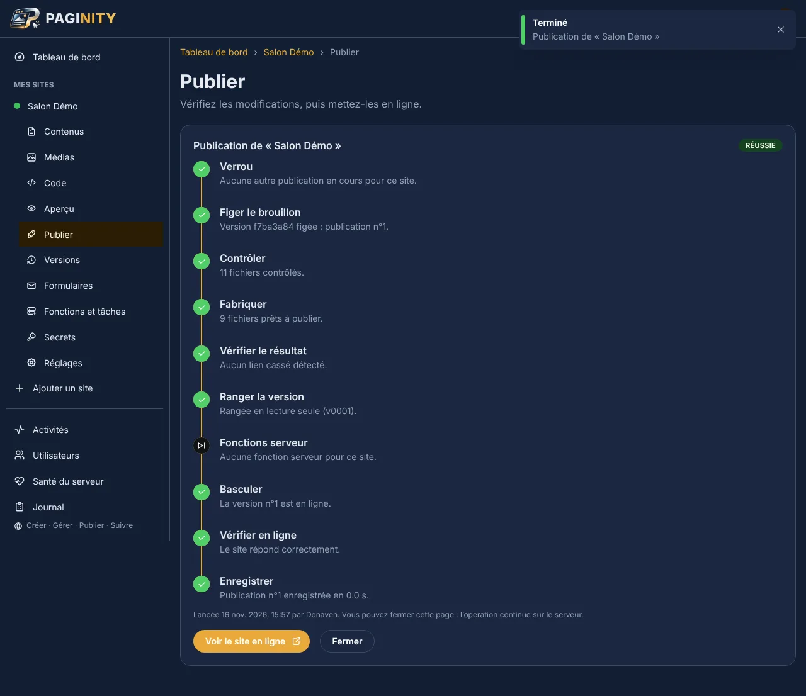

> **Vous pouvez fermer la page** : la publication continue sur le serveur. La cloche 🔔 et la page **Activités** vous
> en donnent le résultat.

**Pourquoi c'est sûr**
- La nouvelle version est **entièrement préparée et vérifiée avant** de remplacer l'ancienne : le site ne
  s'interrompt jamais.
- Si un contrôle échoue (fichier abîmé, page d'accueil manquante…), la publication s'arrête avec une explication, et
  **l'ancienne version reste en ligne**.
- Si le site ne répond pas correctement juste après la mise en ligne, PAGINITY **revient tout seul** à la version
  précédente.

Résultat : les visiteurs voient la nouvelle version.

---

## 10. Versions et retour en arrière

Ouvrez **Versions**. Chaque publication y figure, avec sa date, son auteur et sa note. La version actuellement visible
porte l'étiquette verte **En ligne**.

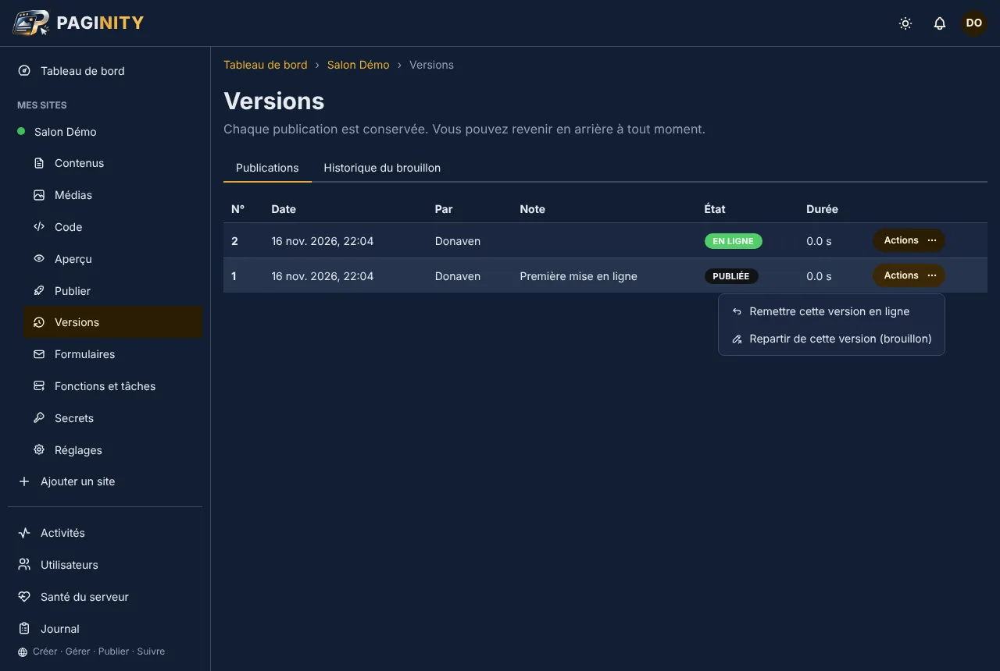

Le bouton **Actions** d'une publication propose deux choses :
- **Remettre cette version en ligne** : le site public revient immédiatement à cette version. Votre brouillon et les
  données (réservations, comptabilité…) **ne sont pas modifiés**.
- **Repartir de cette version (brouillon)** : votre brouillon redevient identique à cette version. Les modifications
  plus récentes restent dans l'historique.

L'onglet **Historique du brouillon** liste chaque enregistrement : qui a modifié quoi, et quand.

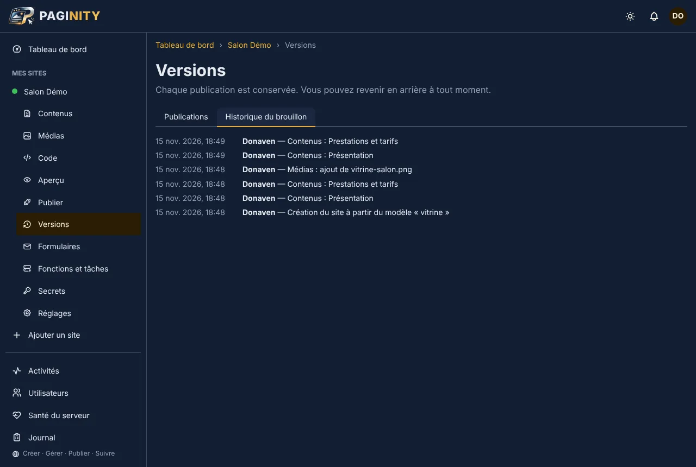

---

## 11. Le mode code

*Réservé au propriétaire et aux administrateurs du site.*

Ouvrez **Code** pour modifier directement les fichiers du site (HTML, CSS, JavaScript, JSON…).

- Choisissez un fichier à gauche (sur téléphone : dans la liste « Fichier »).
- **Enregistrer** (ou Ctrl+S, Cmd+S sur Mac) enregistre dans le brouillon.
- Un fichier JSON contenant une erreur est signalé et souligné en rouge. Sa publication sera refusée tant que l'erreur
  reste.
- **Comparer avec la version en ligne** et **Historique** montrent les changements de ce fichier.
- Les boutons en haut à droite créent un fichier ou un dossier. Le menu « … » d'un fichier permet de le renommer ou de
  le supprimer.

> Les contenus gérés par formulaires peuvent aussi être modifiés ici. PAGINITY empêche les deux modes de s'écraser
> l'un l'autre.

---

## 12. Les messages des formulaires

*Pour les éditeurs, administrateurs et le propriétaire.*

Quand un visiteur envoie un formulaire du site (contact, demande de rendez-vous…), le message arrive dans
**Formulaires**.

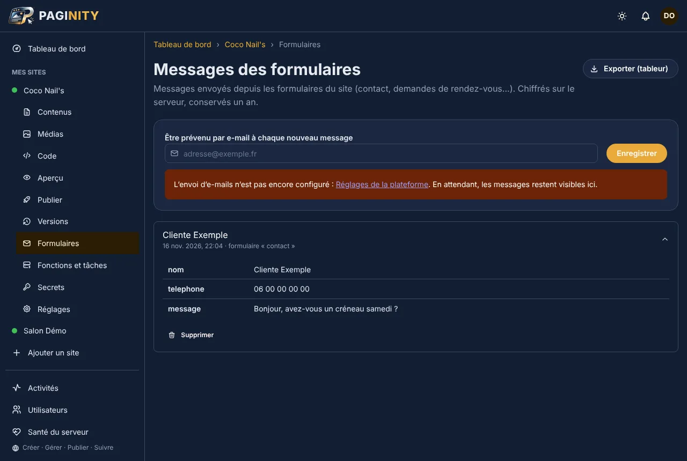

- Les messages **nouveaux** sont en gras. Cliquez pour lire le détail ; le message est alors marqué comme lu.
- **Supprimer** efface définitivement un message. **Exporter (tableur)** télécharge tous les messages pour Excel ou
  LibreOffice (une confirmation d'identité est demandée).
- Indiquez une adresse dans **Être prévenu par e-mail** pour recevoir chaque nouveau message. Il faut que l'envoi
  d'e-mails soit configuré (chapitre 17).
- Les robots qui remplissent les formulaires automatiquement sont écartés sans bruit.
- Les messages sont **chiffrés** sur le serveur et effacés automatiquement au bout d'un an.

---

## 13. Fonctions et tâches planifiées

Certains sites, comme Coco Nail's, ont des **fonctions** : réservation reliée à l'agenda, factures, compta, rappels
par SMS… Lors d'une publication, PAGINITY les prépare et vérifie qu'elles fonctionnent toutes **avant** de mettre la
nouvelle version en ligne.

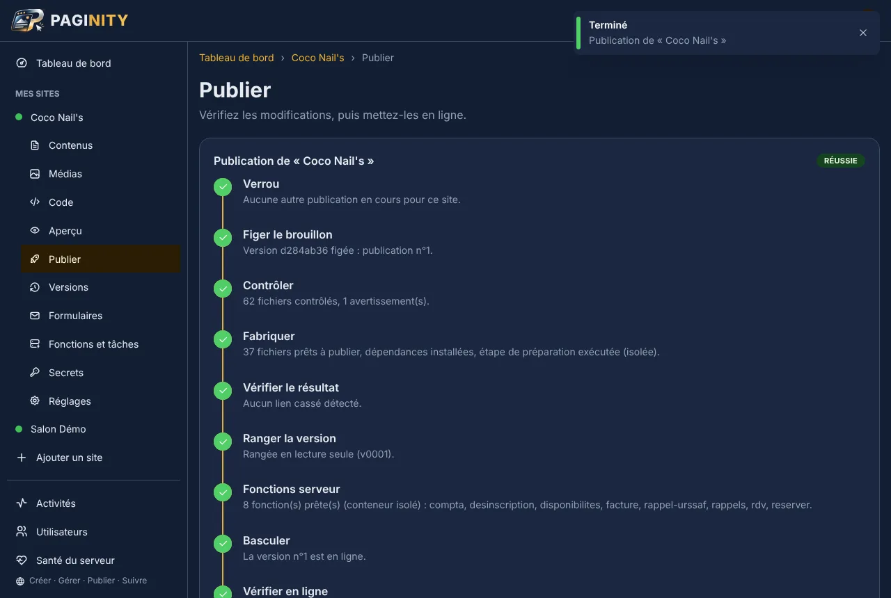

Ouvrez **Fonctions et tâches** pour les suivre.

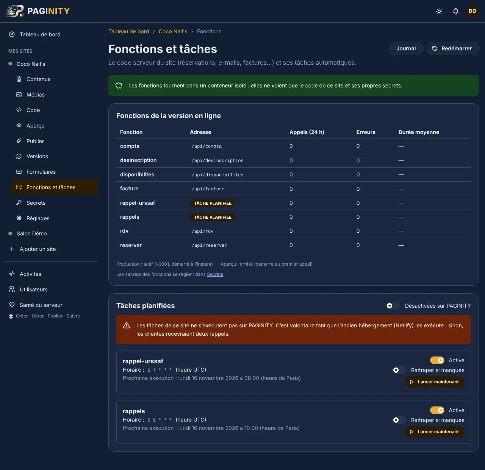

- **Le bandeau vert** confirme que les fonctions tournent dans une « boîte » isolée : elles ne voient que le code de
  ce site et ses propres secrets.
- **Le tableau** donne, pour chaque fonction, son adresse, son nombre d'appels et d'erreurs sur 24 heures, et sa durée
  moyenne.
- **Journal** affiche les messages techniques des fonctions (les secrets y sont toujours masqués, comme dans les alertes, les e-mails et l’historique des tâches).
- **Redémarrer** relance les fonctions du site.

**Tâches planifiées**
- Leur horaire est écrit en heure universelle (UTC), comme chez Netlify. PAGINITY affiche aussi la **prochaine
  exécution en heure de Paris**.
- ⚠️ Pour un site importé, elles sont **désactivées par défaut** : tant que l'ancien hébergement (Netlify) les
  exécute, il ne faut pas les activer, sinon les clientes recevraient **deux rappels**. L'interrupteur en haut à droite
  les active, après un avertissement.
- **Active** : met en pause une tâche précise.
- **Rattraper si manquée** : si le serveur était éteint à l'heure prévue, la tâche est exécutée à son retour (dans les
  6 heures). C'est désactivé par défaut, car un rappel envoyé en retard peut surprendre.
- **Lancer maintenant** exécute la tâche immédiatement. C'est une exécution **réelle** : elle peut envoyer de vrais
  SMS ou e-mails.
- Sous chaque tâche, l'historique de ses exécutions (réussie, échouée, manquée). En cas d'échec, PAGINITY **ne
  relance jamais automatiquement** la tâche (pour ne pas envoyer deux fois un SMS) : il vous prévient par une alerte.

---

## 14. Les secrets

*Réservé au propriétaire et aux administrateurs du site.*

Les fonctions ont besoin de mots de passe et de clés pour parler à Google, OVH ou SumUp. Ils se rangent dans
**Secrets**.

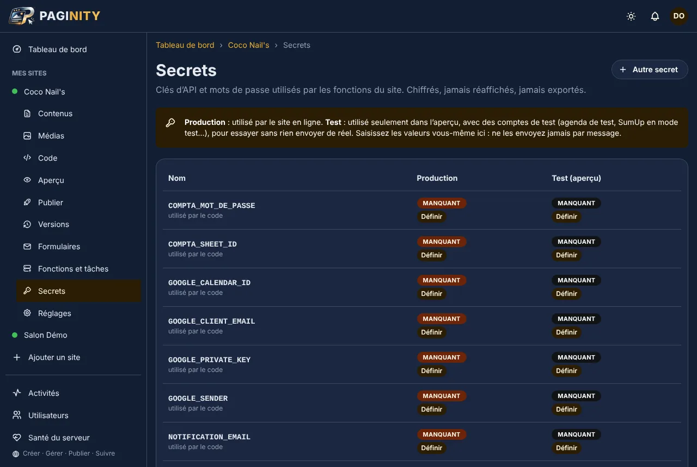

- PAGINITY **repère tout seul** les noms dont le code a besoin. Un « Manquant » orange signale ce qui reste à saisir.
- **Production** : les valeurs utilisées par le site en ligne.
- **Test** : les valeurs utilisées **uniquement dans l'aperçu**, avec des comptes de test (agenda de test…). Sans
  secrets de test, les fonctions ne tournent pas dans l'aperçu. Par sécurité, PAGINITY **refuse une clé de test
  identique à la clé de production** : utilisez la clé « bac à sable » ou « test » que fournit le service.

Cliquez sur **Définir** (ou **Remplacer**), saisissez la valeur, puis **Enregistrer**.

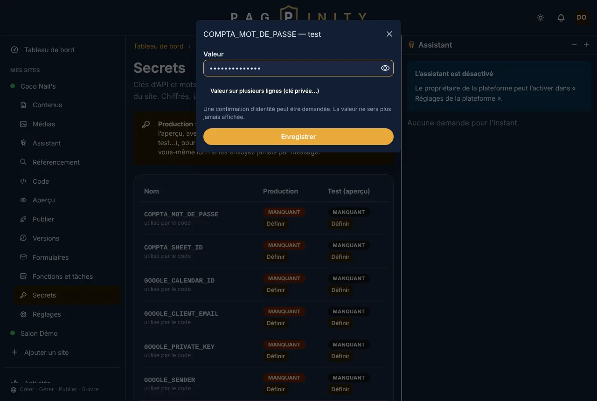

Pour une clé sur plusieurs lignes (comme une clé privée Google), utilisez **Valeur sur plusieurs lignes**.

Comme c'est une action sensible, PAGINITY vous demande de **confirmer votre identité** (mot de passe et code). Cette
confirmation reste valable 10 minutes.

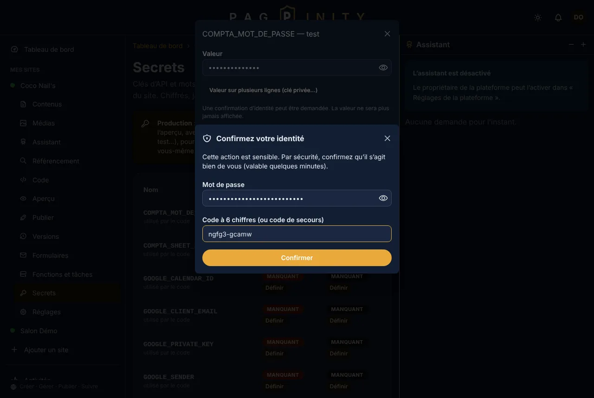

> 🔒 Une valeur enregistrée est **chiffrée** et ne sera **plus jamais affichée** : on peut seulement la remplacer ou la
> supprimer. Ne communiquez jamais un secret par message ou par e-mail : saisissez-le vous-même ici.

---

## 15. Réglages d'un site, personnes, export

Ouvrez **Réglages** dans le menu du site.

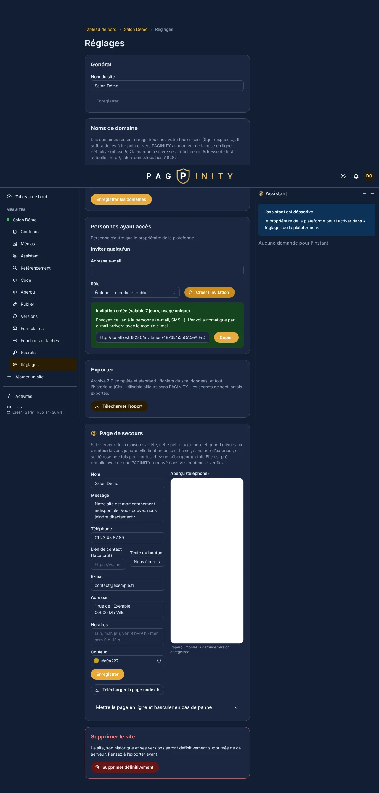

- **Général** : le nom du site.
- **Noms de domaine** : les adresses du site (par exemple `monsite.fr` et `www.monsite.fr`). Leur branchement réel se
  fera en phase 5.
- **Personnes ayant accès** : changez le rôle d'une personne ou retirez son accès.
- **Inviter quelqu'un** :
  1. saisissez son e-mail et choisissez son rôle ;
  2. cliquez sur **Créer l'invitation** ;
  3. envoyez-lui le lien affiché (valable 7 jours, utilisable une seule fois).

  La personne crée son mot de passe puis configure sa double authentification.
- **Exporter** télécharge une archive complète : fichiers du site, données, messages des formulaires et tout
  l'historique. Elle est utilisable ailleurs, sans PAGINITY, et peut être **réimportée** dans PAGINITY
  (*Ajouter un site › Importer une archive*) : le site est reconstruit avec son historique et ses messages.
  Les secrets ne sont jamais exportés : seuls leurs noms sont indiqués, pour les ressaisir. L'archive contient des
  données personnelles (messages) : conservez-la en lieu sûr.
- **Supprimer le site** (propriétaire seulement) demande de retaper le nom du site. Pensez à exporter avant.

---

## 16. Suivre la plateforme

*Réservé au propriétaire.*

**Activités** : toutes les opérations longues (publications, imports, remises en ligne), avec le détail de chaque
étape. Elles continuent même navigateur fermé.

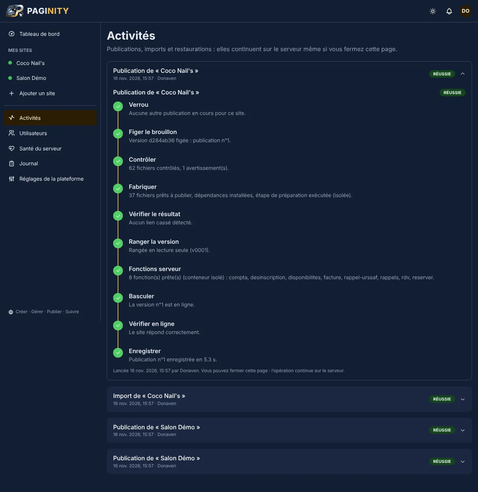

**Utilisateurs** : toutes les personnes, leurs accès site par site, les invitations en attente. **Désactiver**
bloque immédiatement un compte (toutes ses sessions sont fermées).

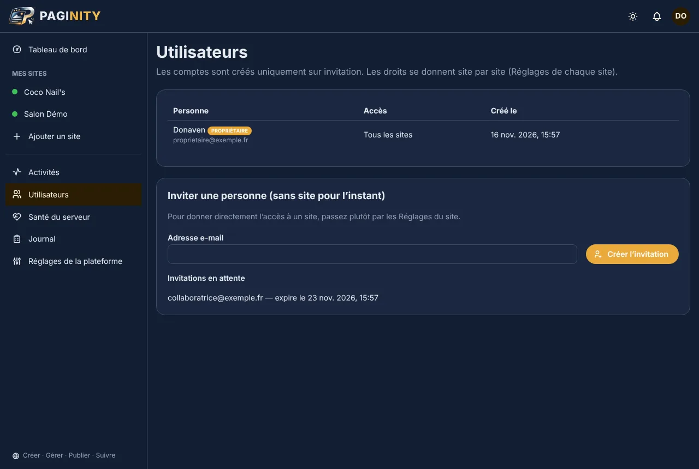

**Santé du serveur** : disque, mémoire, charge, température (sur le Raspberry Pi), état des sauvegardes et de la
surveillance.

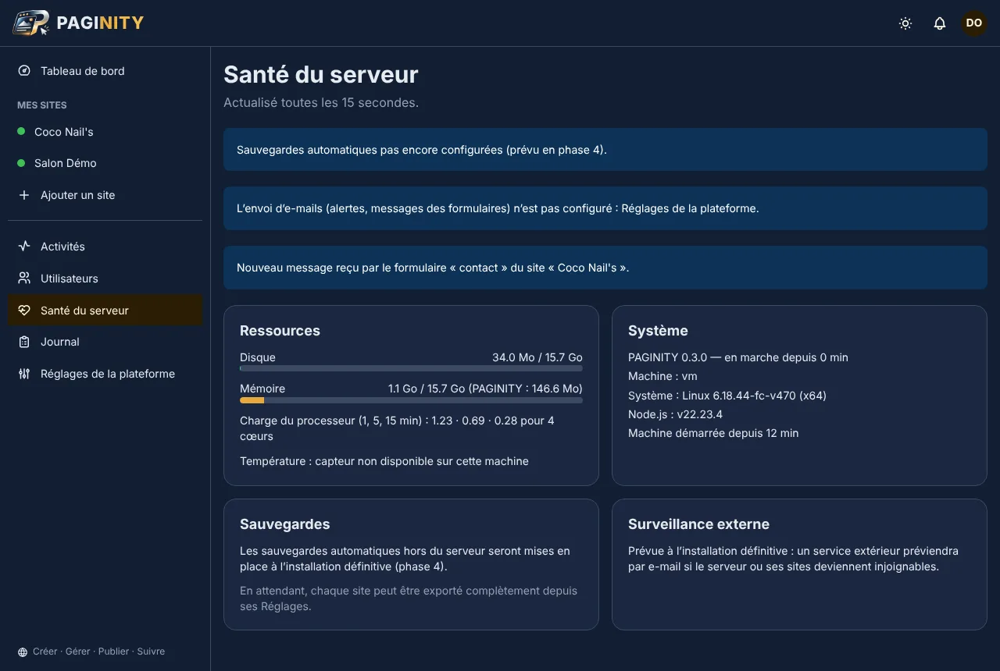

**Journal** : qui a fait quoi, quand, sur quel site et depuis quelle adresse (connexions, publications, secrets
modifiés…). Il est conservé un an.

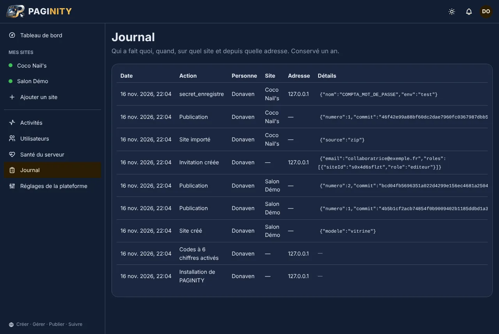

---

## 17. Réglages de la plateforme (e-mails)

*Réservé au propriétaire.*

Pour recevoir les alertes et les messages des formulaires par e-mail, renseignez le serveur d'envoi.

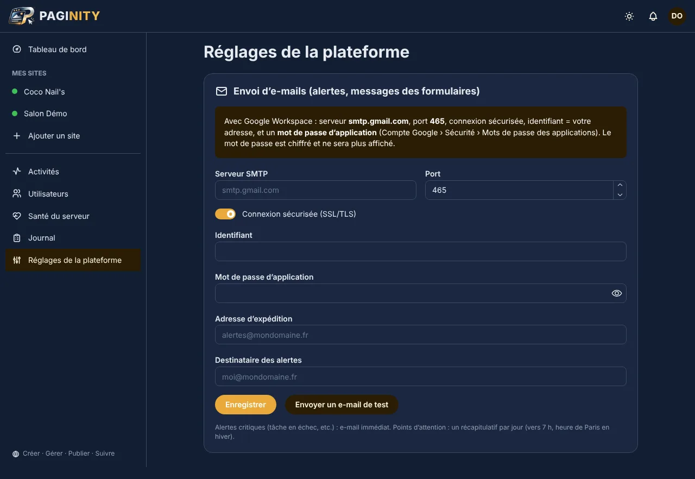

Avec Google Workspace :
1. **Serveur SMTP** : `smtp.gmail.com` ; **Port** : `465` ; laissez **Connexion sécurisée** coché.
2. **Identifiant** : l'adresse Google qui enverra les e-mails.
3. **Mot de passe d'application** : à créer dans votre compte Google (*Sécurité › Mots de passe des applications*).
   Ce n'est pas votre mot de passe habituel.
4. **Adresse d'expédition** et **destinataire des alertes**.
5. **Enregistrer**, puis **Envoyer un e-mail de test** pour vérifier.

Les alertes urgentes (par exemple une tâche planifiée en échec) partent immédiatement. Les points à vérifier sont
regroupés dans un récapitulatif quotidien.

---

## 18. Mon profil et ma sécurité

Cliquez sur votre pastille en haut à droite, puis **Mon profil et sécurité**.

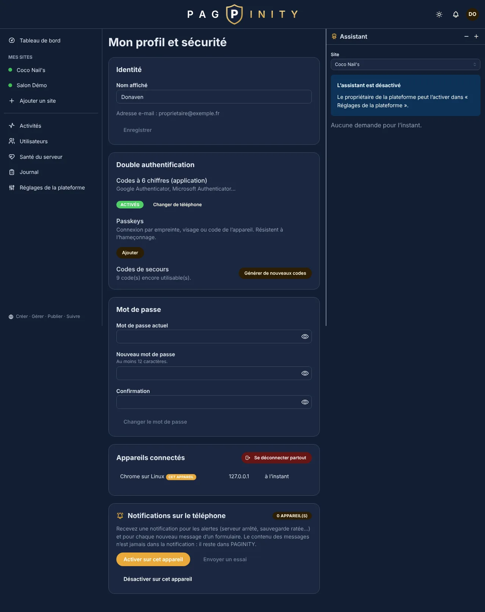

- **Identité** : le nom affiché.
- **Double authentification** :
  - activer les codes à 6 chiffres ;
  - ajouter une passkey par appareil (téléphone, ordinateur) ;
  - générer de nouveaux codes de secours ;
  - le nombre de codes de secours restants est affiché.
- **Mot de passe** : en le changeant, tous vos autres appareils sont déconnectés.
- **Appareils connectés** : la liste de vos sessions. **Déconnecter** une session inconnue, ou **Se déconnecter
  partout** en cas de doute (téléphone perdu…).

---

## 19. Sur téléphone et tablette

PAGINITY fonctionne dans le navigateur du téléphone ou de la tablette (Safari, Chrome…), sans rien installer.

| Tableau de bord | Menu | Contenus | Médias |
|---|---|---|---|
| 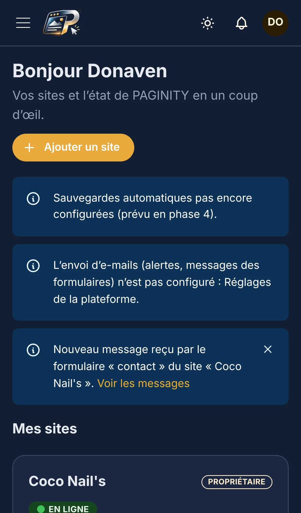 | 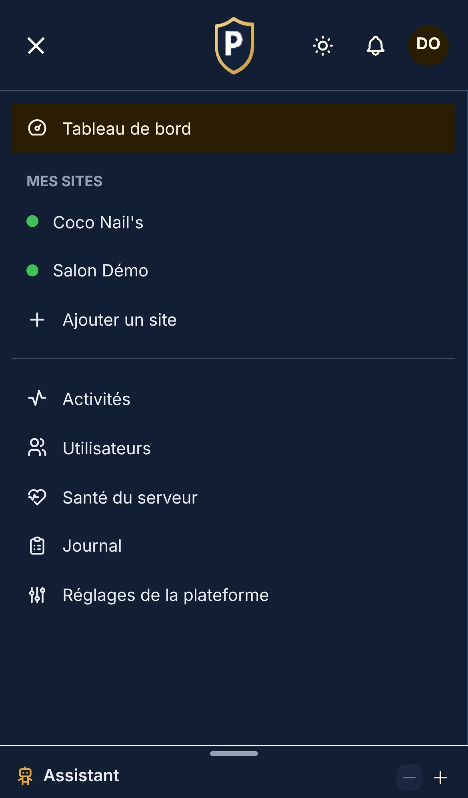 | 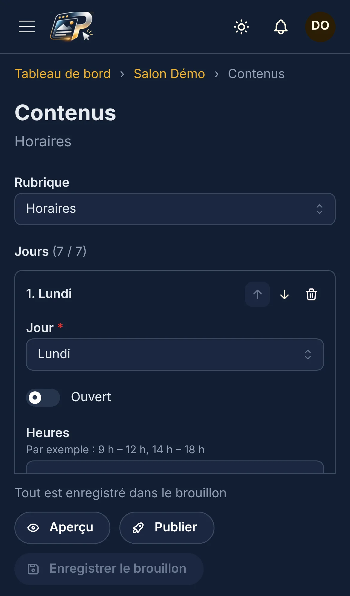 | 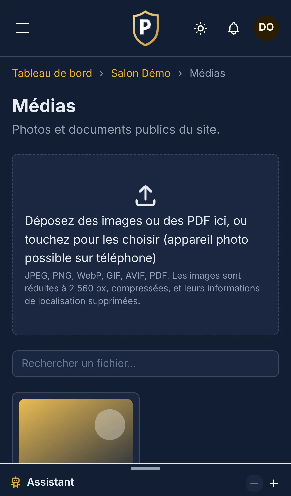 |

- Le bouton ☰ en haut à gauche ouvre le menu.
- Dans **Contenus**, la rubrique se choisit dans la liste « Rubrique ».
- Dans **Médias**, touchez la zone d'envoi pour choisir une photo ou en prendre une.
- Pour avoir une icône sur l'écran d'accueil : sur iPhone, *Partager › Sur l'écran d'accueil* ; sur Android, menu
  ⋮ *› Ajouter à l'écran d'accueil*.
- Le mode code est utilisable sur téléphone pour une petite correction, mais il est plus confortable sur ordinateur.

---

## 20. En cas de problème

| Situation | Que faire |
|---|---|
| J'ai perdu mon téléphone | Connectez-vous avec un **code de secours**. Puis, dans votre profil : **Se déconnecter partout**, supprimez l’ancienne passkey et cliquez sur **Changer de téléphone** pour installer les codes à 6 chiffres sur le nouveau téléphone. |
| Je n'ai plus de code de secours | Depuis votre profil (connecté) : **Générer de nouveaux codes**. Si vous ne pouvez plus vous connecter du tout : sur la machine elle-même (clavier et écran, ou connexion SSH), la commande **`paginity-admin reinitialiser-2fa votre@adresse --confirmer`** supprime l’ancienne double authentification ; vous la reconfigurez à la connexion suivante (le mot de passe reste exigé). `paginity-admin aide` liste les autres commandes de secours (débloquer, nouveau mot de passe…). |
| « Trop de tentatives » | Attendez le nombre de minutes indiqué, puis réessayez calmement, de préférence depuis un appareil où vous vous êtes déjà connecté. En cas d’urgence, sur la machine : `paginity-admin debloquer`. |
| « Ce fichier a été modifié ailleurs » | Quelqu'un (ou vous, dans un autre onglet) a enregistré entre-temps. Rien n'est perdu. Rechargez la dernière version, puis refaites votre modification. |
| « Certains champs sont à corriger » | Les champs en rouge indiquent le problème (champ obligatoire vide, format d'heure…). |
| La publication a échoué | **L'ancienne version reste en ligne.** Ouvrez **Activités** : l'étape en rouge explique la cause (JSON invalide, fonction en erreur…). Corrigez, puis publiez à nouveau. |
| Le site ne montre pas ma modification | Vérifiez qu'elle est **publiée** (pas seulement enregistrée en brouillon). Puis rechargez la page du site (sur ordinateur : Ctrl+F5). |
| Je veux revenir à la version d'hier | **Versions › Actions › Remettre cette version en ligne**. |
| J'ai peur que la clé du coffre ait été copiée | Sur la machine, PAGINITY arrêté : `paginity-admin changer-cle --confirmer`, puis une nouvelle sauvegarde. Vos secrets et messages restent intacts, seule la clé change. |
| Le serveur est en panne ou le disque est perdu | Sur une machine réinstallée : `paginity-admin restaurer <archive> --cle <fichier de clé>` remet tout (comptes, sites, historiques, secrets, messages) à partir d’une sauvegarde faite avec `paginity-admin sauvegarder`. Gardez toujours l’archive et la clé à deux endroits différents. |
| Une alerte « tâche manquée » | Le serveur était éteint à l'heure prévue. Décidez s'il faut lancer la tâche à la main (**Lancer maintenant**). |
| Une photo d'iPhone est refusée (HEIC) | Sur l'iPhone : *Réglages › Appareil photo › Formats › Le plus compatible*, ou partagez la photo en JPEG. |
| Une image SVG est refusée | Par sécurité, la médiathèque n'accepte pas les SVG. Un administrateur peut l'ajouter par le mode code. |

---

## 20 bis. L'assistant IA

*Désactivé par défaut. Réglages réservés au propriétaire : « Réglages de la plateforme › Assistant IA ».*

Dans chaque site, **Assistant** permet de demander une modification de contenu en quelques mots (« ajoute la pose gel à
45 € », « nous sommes fermés du 24 au 26 décembre »). L'assistant prépare une **proposition** : vous voyez le **avant /
après** champ par champ, puis **Accepter (brouillon)** ou **Refuser**. Rien n'est modifié sans votre accord, et une
modification acceptée va **dans le brouillon** : vérifiez l'aperçu, puis publiez comme d'habitude.

- Le **modèle local** (installé sur votre serveur) est gratuit et rien ne sort de chez vous.
- S'il ne sait pas faire, PAGINITY peut passer le relais à **Claude** ou **ChatGPT** (payants), selon vos réglages :
  jamais, avec votre accord (bouton « Oui, passer à l'IA extérieure »), ou automatiquement.
- Vous fixez un **plafond mensuel global** et, si vous voulez, un plafond par service. Au-delà, plus rien n'est envoyé.
- Les IA ne reçoivent que les **contenus publics** du site : jamais les secrets, les messages des clientes ni la compta.
- **Ce qui s'est passé** (sous chaque demande) détaille chaque étape : quel modèle, pourquoi le relais, le coût.

**Le panneau Assistant** reste ouvert sur toutes les pages (à droite sur ordinateur, en bas sur téléphone). Le bouton
**−** dans l'angle le réduit complètement, **+** l'agrandit ; vous pouvez aussi tirer son bord. La taille choisie est
retenue sur chaque appareil.

**Plusieurs modèles locaux** : dans les réglages, « Ajouter un modèle local » (par exemple GLM, Qwen3-Coder, Kimi,
DeepSeek). Chacun a son interrupteur, un bouton « Essayer » et peut être monté ou descendu dans la liste.

**Salle de réunion** (à activer dans les réglages) : chaque IA propose une fois, puis la plus forte dans le domaine de la
demande (*Textes* ou *Données*) relit toutes les propositions et rend la version finale. Vous pouvez choisir le domaine
au moment de la demande et désigner vous-même le vérificateur de chaque domaine. Sous la proposition, « Propositions des
autres IA » montre ce que chacune avait proposé. Vos « Accepter » et « Refuser » améliorent les notes des IA.

**Il pose une question** quand il lui manque une information (« quel prix ? ») : répondez dans la case, la demande
repart complétée. **« Annuler cette modification »** remet le brouillon comme avant une proposition acceptée (si
personne n'a retouché la rubrique depuis). **Dicter** (si le propriétaire l'a autorisé) : la voix est transcrite par
le service du navigateur (Google ou Apple).

**Pages et styles** (personnes ayant accès au Code) : l'assistant peut aussi modifier les fichiers HTML et CSS
(couleurs, mise en page, textes fixes). Vous voyez les lignes changées, et **« Voir avant / après »** montre les deux
versions du site côte à côte. Il ne peut jamais ajouter de programme (script), de lien vers un autre site, ni
toucher au JavaScript ou au code serveur.

**Diagnostic du site** (en bas de la page Assistant) : PAGINITY vérifie publications, fonctions, liens et alertes, et
explique ce qu'il trouve, avec un conseil. Rien n'est modifié. Si l'assistant est actif, un modèle installé sur la
machine reformule le tout.

**Démarrage rapide** (réglages de l'assistant) : « Détecter les modèles installés » trouve les modèles d'Ollama et
les ajoute en un clic.

**Banc d'essai** (en bas des réglages de l'assistant) : « Lancer le banc d'essai » pose 12 demandes types à chaque modèle
local sur un salon imaginaire (vos sites ne sont pas touchés) et affiche une note sur 100 pour les *Textes* et les
*Données*, le nombre de réussites, le temps moyen et le coût. « Détail » explique chaque échec. Ces notes servent à choisir
le vérificateur final de la salle de réunion. Les IA payantes ne passent le banc que si vous cochez « Inclure les IA
payantes », toujours dans vos plafonds. Chaque proposition que vous acceptez devient aussi une demande type (20 au
plus) : les IA sont alors notées sur vos vraies demandes. « Les oublier » efface cette liste.

---

## 20 ter. Protéger le site : sauvegarde, alerte, page de secours

*Réglages de la plateforme (propriétaire) et Réglages de chaque site.*

**Sauvegarde automatique (hors de la machine).** Choisissez une **phrase de sauvegarde** (au moins 16 caractères,
par exemple quatre mots sans rapport) et **notez-la sur papier, hors de la maison** : sans elle, les sauvegardes ne
s'ouvrent pas. Indiquez ensuite un dossier *hors des données de PAGINITY* : disque USB, ou dossier synchronisé avec
Google Drive / OneDrive. Chaque nuit à l'heure choisie, PAGINITY y dépose un fichier `paginity-auto-….paginity`,
chiffré : Google ne peut pas le lire. Les plus anciens sont effacés (14 gardés par défaut). Une fois par mois,
PAGINITY **essaie de restaurer** la dernière sauvegarde dans un dossier temporaire ; en cas d'échec : alerte.
« Sauvegarder maintenant » et « Essayer de restaurer la dernière » font la même chose à la demande.
*Panne totale* : sur la nouvelle machine, `paginity-admin ouvrir-sauvegarde <fichier> <dossier>` (la phrase est
demandée), puis `paginity-admin restaurer <archive> --cle <fichier de clé>` comme indiqué à l'écran.

**Alerte si le serveur s'arrête.** Un serveur éteint ne peut prévenir personne : PAGINITY envoie donc un petit signal
toutes les 5 minutes à un service de surveillance gratuit (healthchecks.io ou équivalent). Si les signaux
s'arrêtent, c'est ce service qui vous prévient (e-mail, SMS…). Si PAGINITY tourne mais va mal (disque plein, base
abîmée, sites arrêtés), il envoie un signal « en panne ». La marche à suivre est rappelée dans la carte.

**Page de secours.** Dans les Réglages d'un site : une petite page autonome (nom, téléphone, bouton WhatsApp, e-mail,
adresse, horaires), pré-remplie depuis vos contenus. Téléchargez-la (`index.html`) et déposez-la chez un hébergeur
gratuit. En cas de panne longue, faites pointer le domaine vers elle chez Squarespace (Domaines › DNS) : avec
Squarespace, cette bascule est **manuelle** (quelques minutes à quelques heures).

**Matériel conseillé** : un petit onduleur pour le serveur (environ 60 €).

## 20 quater. Confort

- **Visites** (page de chaque site) : pages vues par jour sur 7, 30 ou 90 jours, et les pages les plus vues. Sans
  cookies ni donnée personnelle (pas de bandeau à afficher) ; les robots ne sont pas comptés. Ce sont des pages vues,
  pas des personnes différentes.
- **Vérifier sur téléphone avant de publier** (page Publier) : le brouillon dans un cadre de téléphone.
- **Failles de sécurité connues** (Réglages de la plateforme) : « Vérifier maintenant » demande au registre de npm si
  un composant de PAGINITY a une faille connue (seule la liste des composants est envoyée). Rien n'est mis à jour
  tout seul : PAGINITY prévient, la mise à jour se fait avec `paginity-maj`. Vérification hebdomadaire possible.
- **Notifications sur le téléphone** (Mon profil) : « Activer sur cet appareil ». Vous recevez les alertes et un
  avis à chaque nouveau message d'un formulaire (le contenu du message n'est pas dans la notification). Sur iPhone,
  ajoutez d'abord PAGINITY à l'écran d'accueil.

## 20 quinquies. Référencement (audit)

*Chaque site › **Référencement**. Lecture seule : rien n'est jamais modifié. Aucun compte Google n'est nécessaire.*

« **Lancer l'audit** » lit le site tel que les moteurs de recherche le reçoivent : le **brouillon** (fabriqué pour
l'occasion, sans toucher à votre aperçu) ou le **site en ligne**. Il vérifie notamment : titres et descriptions de
chaque page, titre principal, langue, affichage sur téléphone, plan du site (`sitemap.xml`) et `robots.txt`, pages
exclues des moteurs (« noindex »), adresse « canonical », aperçu de partage (Facebook, WhatsApp), données pour Google
(fiche d'entreprise, FAQ), **téléphone identique** sur le site et dans ces données, liens cassés, images lourdes ou
sans texte alternatif.

Les constats sont classés en **Problèmes** (gênent nettement l'affichage dans les moteurs), **À améliorer** et **À
savoir** (souvent volontaire, comme une page de remerciement exclue des moteurs). Chacun indique la page concernée et
quoi faire. Il n'y a **pas de note** : seulement des constats vérifiables. « **Vérifié et correct** » liste ce qui va
bien. Après un nouvel audit, PAGINITY signale les constats **nouveaux** et ceux **corrigés**.

L'audit lit le HTML avant l'exécution du JavaScript : un texte affiché uniquement par JavaScript n'est pas vu (c'est
aussi ce que reçoivent d'abord les moteurs). Les repères de longueur (titre, description) sont des usages courants,
pas des règles officielles de Google.

**Chaque semaine** (case à cocher, Administrateur du site) : PAGINITY refait l'audit du site en ligne et crée une
alerte uniquement s'il apparaît un **nouveau** problème.

## 21. Ce qui n'est pas encore disponible

| Fonction | Prévue |
|---|---|
| Installation sur le Raspberry Pi (ou mini-PC), accès depuis internet, accès local de secours | Phase 4 |
| Branchement de vos noms de domaine, bascule de Coco Nail's depuis Netlify | Phase 5 |
| Éditeur visuel par blocs (créer des pages sans code) | Phase 6 |
| Publication programmée | Phase 6 |
| Envoi automatique des invitations par e-mail (aujourd'hui : lien à copier) | Plus tard |
